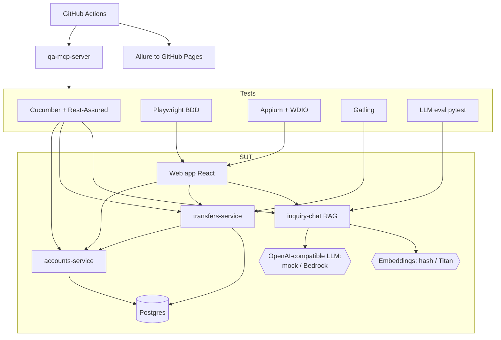

# bank-qa-automation

[](https://github.com/mini4141/bank-qa-automation/actions/workflows/ci.yml)

Full-stack test automation for a small microservice banking app with an LLM inquiry chat. The system under test (SUT) is deliberately small. The deliverable is the **quality platform** around it: BDD suites for API, web and mobile, Gatling performance tests, an LLM/RAG evaluation harness (hallucination, bias, drift, robustness, prompt injection), an MCP server that exposes test tools to AI assistants, and CI that publishes one Allure report.

- Live Allure report (GitHub Pages): https://mini4141.github.io/bank-qa-automation/
- Proof of everything working: [proof/README.md](proof/README.md)
- Write-up: [docs/PORTFOLIO.md](docs/PORTFOLIO.md)

## Architecture



| Folder | What |
|---|---|
| `sut/` | accounts, transfers (Node 24 + TypeScript + Fastify), web (React + Vite), inquiry-chat (Python FastAPI RAG + mock LLM), FAQ corpus |
| `tests/api` | Cucumber JVM + Rest-Assured + JUnit 5 |
| `tests/web` | Playwright + playwright-bdd, Chromium and WebKit |
| `tests/mobile` | Appium 2 (UiAutomator2) + WebdriverIO + Cucumber, Chrome on an Android emulator |
| `tests/perf` | Gatling (Java DSL) and a `wrk` smoke |
| `llm-eval/` | pytest harness with golden sets, baselines and thresholds |
| `mcp/qa-mcp-server` | MCP server: `seed_test_data`, `run_suite`, `get_report_summary`, `list_flaky_tests` |
| `deploy/k8s`, `infra/` | kind manifests, Terraform for AWS |
| `docs/` | strategy, traceability, charters, defects, QA reports, AI usage, portfolio write-up |

## Quickstart (Windows with Git Bash, or Linux/macOS)

Prerequisites: Docker, Node 24 + pnpm, Java 21 + Maven, Python via `uv`, optionally kind, Terraform, AWS CLI.

```bash
scripts/dev-up.sh        # build and start the SUT with Docker Compose, load demo data
scripts/test-all.sh      # every local suite, then the merged Allure report
scripts/dev-down.sh      # stop and remove volumes
```

Useful single commands:

```bash
scripts/run-suite.sh api            # sut-unit | api | web | perf | llm-eval | mobile
scripts/k8s-test.sh                 # deploy to kind and run the API suite there
SUT_BUG_ROUNDING=1 docker compose up -d transfers   # flip the seeded fee-rounding bug
```

Web app: http://localhost:8080 . Mobile tests need an Android emulator; CI runs them on one.

## Deploy to AWS and destroy

AWS runs from this PC, never from CI. Profile `bank-qa-automation-deployer`, region `ap-southeast-2`.

```bash
scripts/deploy.sh          # Terraform, push images, seed, run api/web/perf/llm-eval against the ALB
scripts/capture-proof.sh phase2
scripts/destroy.sh && scripts/verify-destroyed.sh
```

The stack is ephemeral and costs a few dollars per hour of life. See [docs/PORTFOLIO.md](docs/PORTFOLIO.md) for the cost estimate.

## Secrets

Local keys live in `.env` (gitignored; template in `.env.example`). In AWS the database URL and LLM configuration are in Secrets Manager and injected into tasks. `scripts/rotate-secret.sh local|cloud` rotates them. Nothing secret is logged.
