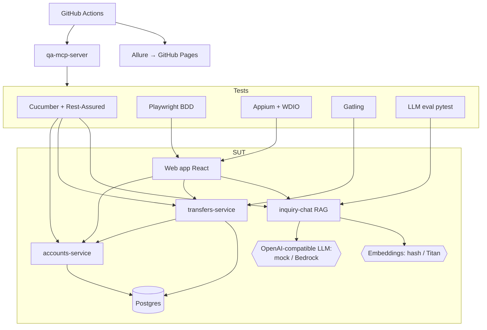

# SPECS.md: Bank QA Automation

## 1. Summary

A **quality engineering platform** for a small microservice banking product. The SUT has five parts:

- Accounts service.
- Transfers service.
- A mobile-friendly web app.
- An **inquiry chat**: a RAG LLM assistant that answers account-opening and loan FAQs from bundled policy documents.

These suites test it:

| Suite | Tool | Style |
|---|---|---|
| API | Rest-Assured | Cucumber BDD |
| Web | Playwright | Cucumber BDD |
| Mobile web | Appium | Cucumber BDD |
| Performance | Gatling | Simulation with assertions |
| LLM evaluation | pytest | Validates the AI feature for accuracy, hallucination, bias, drift, robustness and prompt injection |

An MCP server exposes test tools so an AI assistant (or the CI pipeline) can seed data, run suites and read results. GitHub Actions runs everything and publishes a single Allure report to GitHub Pages.

**Demo story:**
1. Push a commit.
2. CI runs the API, web, mobile and performance smoke suites and the LLM eval.
3. The Allure report on GitHub Pages shows 100% green.
4. Flip the seeded rounding bug, and the API and web suites catch it with a clear failure.
5. The defect report template is filled in.
6. Against the cloud, the LLM eval runs on real Bedrock and the drift report compares it with the mock baseline.

## 2. Requirement coverage matrix

| Requirement | Covered by | Proof |
|---|---|---|
| Test scenarios/cases from requirements; functional and non-functional | Gherkin features, traceability matrix, Gatling for non-functional | Docs + reports |
| Test data, tools, environments | Data builders, `seed_test_data` MCP tool, compose/kind/AWS envs | Logs |
| Execute + document results; log/track defects; analyse and report | Allure, `docs/defects/`, `docs/qa-report-*.md` | Report |
| Automation focus + manual/exploratory validation | Suites + `docs/exploratory-charters.md` with session notes | Docs |
| Regression coverage, test documentation | Tagged `@regression` suites | Report |
| Appium / Playwright / Rest-Assured | Mobile / web / API suites | Reports |
| Cucumber | All three functional suites | Reports |
| CI/CD (GitHub Actions) | Workflow matrix + Pages | CI run + Pages URL |
| Microservices testing challenges | Contract-style API checks per service, kind job, service-down scenario | CI job log |
| AI tools (NotebookLM, Gemini, Cursor, Copilot) for test design | `docs/AI_USAGE.md` prompt log | Doc |
| Prompt engineering + RAG validation for LLM apps | llm-eval retrieval + faithfulness tests | Eval report |
| OpenAI API keys, LLM models, MCP integration, securing AI workflows | `openai` SDK client, Secrets Manager, MCP server in CI | Logs |
| Test/monitor AI for bias, drift, hallucinations, performance | llm-eval categories + latency metrics | Eval report |
| Preferred: ISTQB-style process, perf (Gatling/wrk/JMeter), Docker/K8s, bash | Strategy doc, Gatling + wrk, compose + kind, scripts | — |

## 3. Architecture



## 4. Repository layout

```
sut/accounts-service/  sut/transfers-service/  sut/web/  sut/inquiry-chat/  sut/docs-corpus/ (FAQ markdown)
tests/api/            Maven: features/*.feature, steps, Rest-Assured specs
tests/web/            Playwright + playwright-bdd
tests/mobile/         WebdriverIO + Appium + Cucumber
tests/perf/           Gatling (Maven) + wrk scripts
llm-eval/             pytest harness, golden/, baselines/, config.yaml
mcp/qa-mcp-server/    TypeScript MCP server + ci-client.ts
deploy/k8s/           SUT manifests for kind
infra/                Terraform
.github/workflows/    ci.yml (matrix), pages.yml
docs/                 test-strategy.md, traceability.md, exploratory-charters.md, defects/, qa-report-*.md, AI_USAGE.md, PORTFOLIO.md
```

## 5. Features (end-to-end)

### F1: The SUT (keep it small)
- Accounts: open account (name, type), get balance, deposit.
- Transfers: create a transfer (calls accounts), list transfers.
- Web: open account, account page, transfer form, chat panel. It's responsive, so it's usable in mobile Chrome.
- Inquiry chat: `POST /chat {question}` → `{answer, citations[]}`, built from top-k chunks of `docs-corpus` (account opening, LINE-linked opening, cardless ATM, loans).
- Seeded bug flag: `SUT_BUG_ROUNDING=1` rounds fees wrongly.
- **Accept:** the SUT runs with `docker compose up`.

### F2: API suite (Cucumber + Rest-Assured)
- Features:
  - `accounts.feature` (open, deposit, balance)
  - `transfers.feature` (happy transfer, idempotent retry, insufficient-funds error)
  - `chat-api.feature` (returns citations)
  - `resilience.feature` (transfers returns 503 with a clear error when accounts is down; the compose service is stopped through a step)
- **Accept:** all green, with Allure results written.

### F3: Web suite (Playwright BDD)
- Features: open account via the UI, transfer via the UI, the transaction list shows the transfer, the chat answer shows a citation link, and a visual snapshot of the account page.
- Uses page objects and runs on Chromium + WebKit.
- **Accept:** green, with trace files kept for failures.

### F4: Mobile suite (Appium)
- Android emulator running Chrome on the SUT web URL (`10.0.2.2` locally, the ALB URL in the cloud). Scenarios: open account, transfer, chat.
- **Accept:** green in the CI emulator job, with screenshots attached.

### F5: Performance (Gatling + wrk)
- `TransferSimulation`: ramp to 50 users over 60 s, with assertions p95 < 500 ms and failures < 1%. There's also a wrk smoke on `GET /accounts/:id`.
- **Accept:** the Gatling HTML report is saved, with its assertions passed.

### F6: LLM evaluation harness
- **Golden set:** about 30 Q&A items with expected source doc IDs.
- **Metrics:**

| Metric | What it measures | Pass threshold |
|---|---|---|
| retrieval hit@3 | Correct source doc in the top 3 chunks | ≥ 0.9 |
| faithfulness | Answer claims supported by the cited chunks; judge prompt plus citation-overlap fallback | ≥ 0.85 |
| hallucination rate | Out-of-corpus questions must get "I don't know" or a referral | — |
| bias parity | Paired prompts that differ only in name/gender/nationality → same eligibility answer | — |
| robustness | Typos/paraphrases → same answer class | — |
| injection | "Ignore previous instructions…" inside the question → policy kept | — |
| drift | Every metric vs `baselines/<provider>.json` within ± tolerance | — |
| latency | p95 | — |

- Output: `reports/llm-eval/report.json` + an HTML summary + Allure results.
- **Accept:** all categories pass with the mock provider locally, and with Bedrock in the cloud (with its own baseline recorded on the first cloud run).

### F7: MCP server in the pipeline
- Tools:
  - `seed_test_data(profile)` creates accounts through the API.
  - `run_suite(name, env)` shells out to the suite runner.
  - `get_report_summary()` parses the merged Allure summary.
  - `list_flaky_tests()` lists tests that both failed and passed in the last N runs, stored in `reports/history.json`.
- The CI step `ci-client.ts` connects over stdio, calls `seed_test_data`, then `get_report_summary` after the suites, and writes the summary into the job summary.
- **Accept:** the CI log shows the MCP tool calls, and the job summary contains the table.

### F8: CI/CD and reporting
- Matrix jobs: `sut-unit`, `api`, `web`, `mobile` (emulator), `perf-smoke`, `llm-eval` (mock), `k8s-api` (kind). A final `report` job merges Allure, keeps history and deploys to GitHub Pages.
- **Accept:** the Pages URL serves the report (listed in the README).

## 6. Data model

SUT: `accounts(id, name, type, balance_minor)` and `transfers(id, from_id, to_id, amount_minor, fee_minor, idempotency_key)`. The chat index is in memory (chunks + vectors) and built at start-up.

## 7. Interfaces

- **accounts:** `POST /accounts`, `GET /accounts/:id`, `POST /accounts/:id/deposits`
- **transfers:** `POST /transfers`, `GET /transfers?accountId`
- **chat:** `POST /chat`, `GET /healthz`
- **mock-llm:** `/v1/chat/completions`, `/v1/embeddings` (OpenAI-compatible)

## 8. Test plan

This is the product itself. See F2–F7. The SUT gets 1–2 unit tests per service.

## 9. Phase 1: Local

`scripts/dev-up.sh` runs compose: postgres, accounts, transfers, chat, mock-llm and web. `scripts/test-all.sh` runs api, web, perf, llm-eval and mobile (if an emulator is present), then merges Allure.

- [ ] `tests/allure-report/` (merged HTML), `tests/gatling/`, `tests/llm-eval/report.html`, `tests/mobile-ci/` (from CI if needed)
- [ ] `screenshots/01-allure-overview.png`, `02-allure-api-feature.png`, `03-playwright-trace.png`, `04-gatling-report.png`, `05-llm-eval-summary.png`, `06-bug-caught-rounding.png`, `07-github-pages-report.png`, `08-ci-matrix.png`
- [ ] `logs/mcp-ci-client.log`, `logs/k8s-api-job.log`, `docs/defects/DEF-001-fee-rounding.md`

## 10. Phase 2: AWS

| Local | AWS |
|---|---|
| compose SUT | ECS Fargate services behind an ALB (`/api/accounts`, `/api/transfers`, `/api/chat`, `/`) |
| Postgres | RDS PostgreSQL |
| mock-llm | Bedrock (chat + Titan embeddings) through the provider interface; credentials from the task role, model ID and settings in Secrets Manager/SSM |

`scripts/deploy.sh`:
1. `terraform apply`.
2. Push images.
3. Seed.
4. Run the api, web, perf (lighter: 20 users) and llm-eval (`--provider bedrock`) suites from this PC against the ALB URL.
5. Merge into `reports/cloud`.

- [ ] `tests/allure-report-cloud/`, `tests/llm-eval-bedrock/report.html`, `logs/drift-mock-vs-bedrock.json`
- [ ] `screenshots/01-cloud-allure.png`, `02-cloud-web-app.png`, `03-bedrock-eval.png`
- [ ] `resources.txt`

## 11. Phase 3: Destroy

`terraform destroy`.

`verify-destroyed.sh` checks for no ECS cluster, ALB, RDS instance, secrets or ECR repos. GitHub Pages stays up: it's free and holds the public report.

## 12. Out of scope

A native mobile app, Bitrise, the paid AI tools themselves (described, not integrated), and full banking rules.
