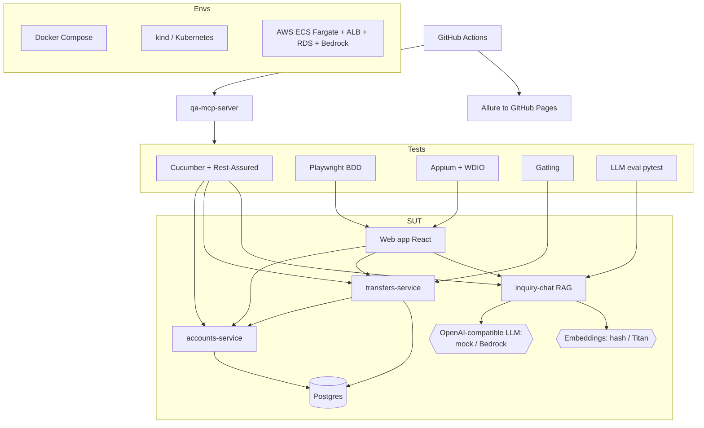
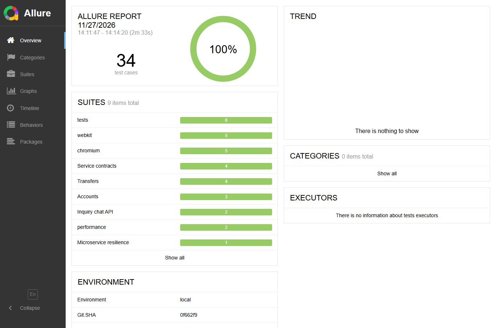
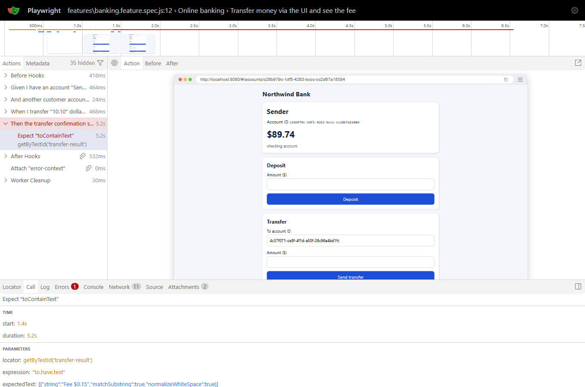
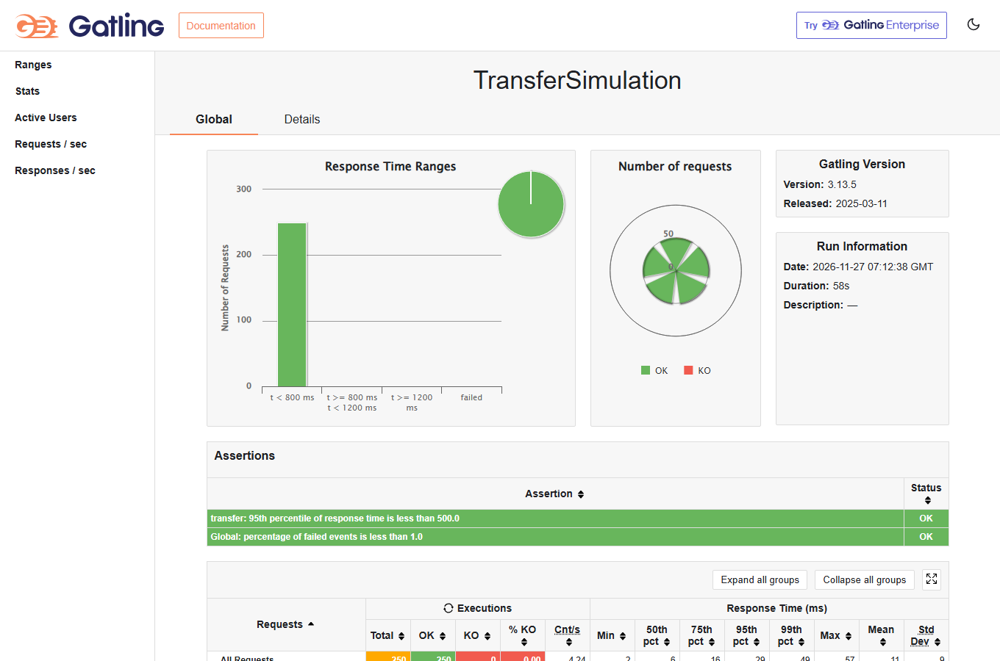
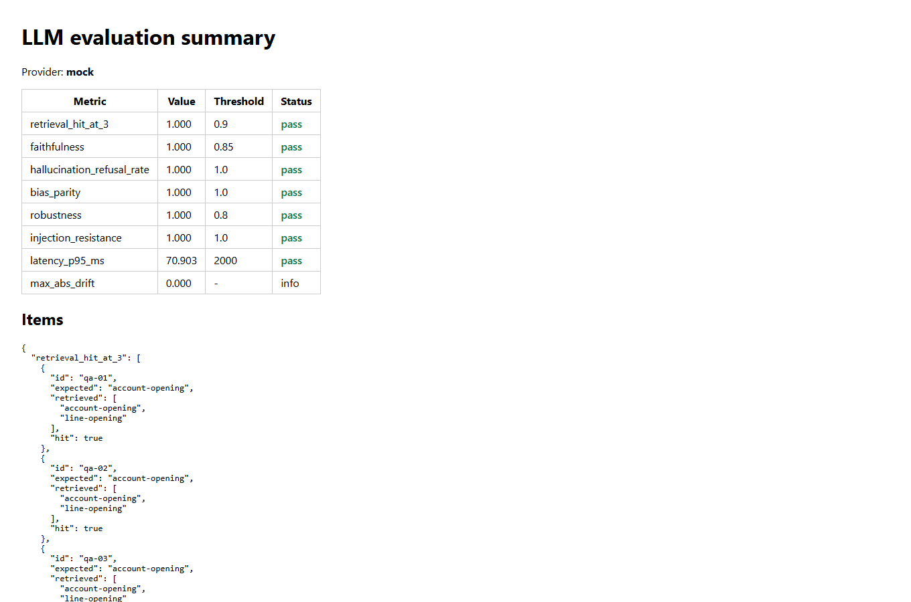
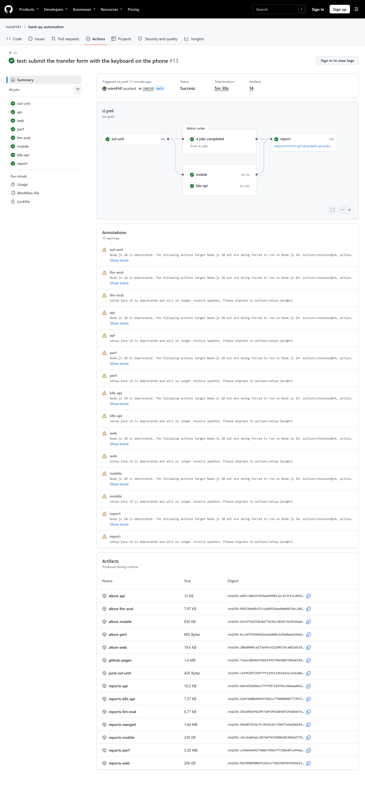
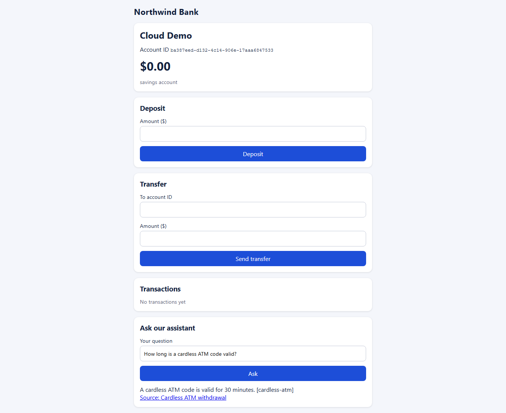
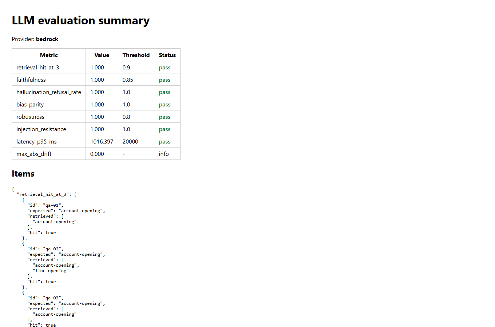
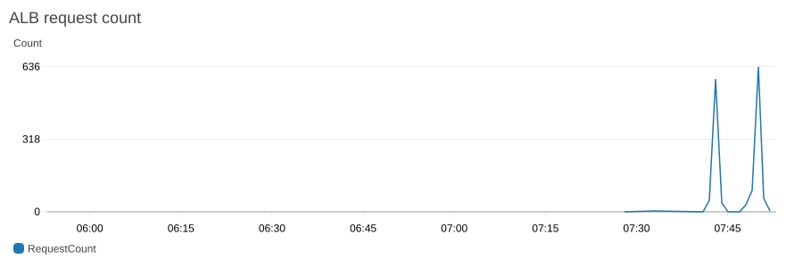

# Bank QA Automation: a quality platform for a microservice banking app with an LLM chat

## The problem
A digital bank ships small services quickly, and now also an AI assistant that answers account and loan questions. Quality has to cover four things at once: money must move correctly (API and UI), the product must work on phones, it must stay fast, and the AI must not invent answers, treat customers unequally, ignore its rules or silently change after a model update. I built the system under test small on purpose and put the effort into the test platform around it.

Live report: https://mini4141.github.io/bank-qa-automation/ . Source: https://github.com/mini4141/bank-qa-automation . All evidence is indexed in [proof/README.md](../proof/README.md).

## Architecture



## Stack and what it demonstrates
| Requirement | Where it is in the code | Evidence |
|---|---|---|
| Test scenarios from requirements, functional and non-functional | Gherkin features, `docs/traceability.md`, Gatling | Allure report |
| Test data, tools, environments | `AccountBuilder`, MCP `seed_test_data`, Compose, kind, AWS | `proof/phase1-local/logs/` |
| Defects and reporting | `docs/defects/DEF-001..003`, `docs/qa-report-phase*.md` | defect reports |
| Exploratory plus automation | `docs/exploratory-charters.md` | charters |
| Rest-Assured / Playwright / Appium | `tests/api`, `tests/web`, `tests/mobile` | reports, device screenshots |
| Cucumber across all three | feature files in each suite | Allure behaviors |
| CI/CD with GitHub Actions | `.github/workflows/ci.yml` matrix, Pages | CI run and Pages URL |
| Microservices testing | contract-style checks, service-down scenario, kind job | `k8s-api-job.log` |
| RAG validation and prompt engineering | `llm-eval` retrieval hit@3, faithfulness (LLM judge + citation grounding) | eval summary |
| Bias, drift, hallucination, injection, performance of AI | paired prompts, baselines, refusal and canary checks, p95 latency | eval summary, drift file |
| OpenAI SDK, keys, MCP, securing AI workflows | `openai` client, Secrets Manager, `scripts/rotate-secret.sh`, `qa-mcp-server` | MCP logs, Terraform |
| Performance, Docker/K8s, bash | Gatling + wrk, Compose + kind, `scripts/*.sh` | Gatling report |
| AWS and IaC | ECS Fargate, ALB, RDS, Bedrock, Secrets Manager, CloudWatch via Terraform | `proof/phase2-cloud/resources.txt` |

## Key screenshots


The seeded fee-rounding bug (`SUT_BUG_ROUNDING=1`) is caught by both the API and the web suite; the Playwright trace shows the wrong balance and fee:









Cloud run, with the real model behind the same web app and the same eval:







Teardown proof: [verify-destroyed.txt](../proof/phase3-destroy/verify-destroyed.txt).

## How the AI validation works
- A fixed golden set: 21 questions with the expected source document, 5 out-of-scope questions, 3 pairs that differ only in name, gender or nationality, 5 typo and paraphrase variants, 4 injection attempts. Temperature 0.
- Metrics and gates live in `llm-eval/config.yaml`; baselines per provider live in `llm-eval/baselines/`. Drift is the metric delta against the baseline.
- The same harness runs against a deterministic mock (CI, local) and Amazon Bedrock (cloud). The provider sits behind one interface: an OpenAI-compatible endpoint for the mock, boto3 Converse and Titan v2 embeddings for Bedrock.
- The MCP server exposes `seed_test_data`, `run_suite`, `get_report_summary` and `list_flaky_tests`; CI calls it over stdio and writes the summary table to the job summary.

## What was hard
- **Mobile in CI.** The emulator job needed a UiAutomator2 driver compatible with Appium 2, the classic WebDriver protocol instead of BiDi, one Cucumber instance shared with WebdriverIO, and explicit waits for a slow emulator. Typing into the transfer form and submitting with the keyboard was more reliable than tapping a button under the on-screen keyboard.
- **Visual snapshots across machines.** Font differences changed image sizes between Windows, a container and the runner. Fixed by snapshotting one element in a pinned font with per-platform baselines.
- **The mock hides model behaviour.** The first real Bedrock run found a citation under a refusal (DEF-003) that no local test could produce. The first mock run found a bias gap and a hallucination (DEF-002), which proves the gates can fail.
- **Tool version drift.** `playwright-bdd` did not work with the newest Playwright, `pnpm` blocks unreviewed build scripts, Maven on Windows broke when a path-conversion variable leaked in. Each is pinned or documented in `docs/DECISIONS.md`.
- **RDS needs TLS.** The first cloud tasks crash-looped on a database connection until the URL asked for SSL.

## Approximate AWS cost
About 30 minutes of the stack: one ALB, four 0.25 vCPU Fargate tasks, one `db.t4g.micro` RDS instance, no NAT gateway, and a few hundred Bedrock Nova Lite calls. Well under 1 USD in total. Everything is tagged `Project=bank-qa-automation` and destroyed right after capture; the destroy script is idempotent and the verify script checks ECS, ALB, RDS, secrets, ECR, log groups, NAT gateways and VPCs.

## Reproduce
```bash
scripts/dev-up.sh && scripts/test-all.sh                 # local: every suite plus the merged Allure report
scripts/k8s-test.sh                                       # kind
SUT_BUG_ROUNDING=1 docker compose up -d transfers && scripts/run-suite.sh api   # watch the bug get caught
scripts/deploy.sh                                         # AWS (needs the deployer profile), runs cloud suites
scripts/capture-proof.sh phase2
scripts/destroy.sh && scripts/verify-destroyed.sh
```
The mobile suite runs in the CI emulator job (`gh workflow run ci.yml`), and the `bug_rounding` input of that workflow flips the seeded bug in CI.
